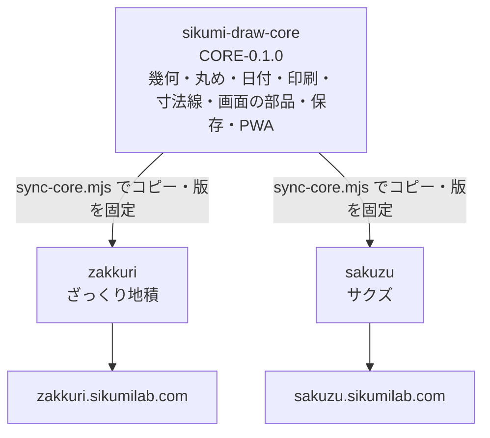

# サクズ 基本設計サマリ（共通モジュールとの関係を含む）

| 項目 | 内容 |
|---|---|
| 版 | 0.1（2026-11-21） |
| もとにした要件定義書 | docs/requirements.md v0.2 |
| 作成者 | 田中孝宗（SIKUMI LAB） |

## 全体構成

- 共通モジュールは、公開サイトを持たない部品のリポジトリです。
- 各アプリは、決まった版をコピーして取り込み、アプリの中に持ちます。そのため、オフラインでも動き、片方のアプリの都合でもう片方が壊れることもありません。

## 主要な設計判断

| 項目 | 決定 | 理由 | 区分 |
|---|---|---|---|
| 実装に使うAI | Codex と Claude Code の両方 | 発案者の回答 | 確定 |
| 共通モジュールの範囲 | 幾何・作図（二円交点など）・丸め・日付・印刷・寸法線・北の記号・画面の部品（ヘッダ、フッタ、パネル、図の操作、日付の入力欄）・保存・作業ファイルの検証・PWA・チェック用のスクリプト。DXFは後の版 | 両方のアプリで同じ答えになるべき部分と、見た目をそろえたい部分を共通にする | 確定 |
| アプリ側に残すもの | zakkuri: 射影変換・縮尺の推定・三斜。sakuzu: 手順の再計算・閉合・部屋・道路・寸法の自動生成 | それぞれのアプリにしかない計算だから | 確定 |
| 共通モジュールの取り込み | スクリプトでコピーし、ハッシュの一覧で書き換えを検出する | 案A（発案者合意）。直接書き換えるとアプリ間で食い違うため | 確定 |
| 手順の再計算 | 手順は前の手順だけを参照し、直した位置から後ろだけを計算し直す | 仕組みが単純で、200点でも十分に速い | 確定 |
| 二円交点の側 | 計算後に選んだ側（左・右）を保存する | 数値を直しても、意図した側の点のままにするため | 確定 |
| 元に戻す | 図面のデータの複製を50件まで履歴に積む | 図面のデータが小さく、最も壊れにくい方式だから | 確定 |
| 図面の縮尺の候補 | 1/20〜1/500 | 店内や駐車場の大きさに合わせた（ざっくり地積とは別の候補） | 【想定】 |
| UI | 両方のアプリで共通の部品とトークンを使う。スマホは図を全画面に表示し、下から引き出すパネルを使う | 発案者の希望（両アプリでそろえる） | 確定 |

## 要件との対応

正典は docs/tasks.md のトレーサビリティ表です。全21機能とC-01〜C-04が、タスクに対応しています（F-019・F-020は後の版、F-021は将来）。

## 作る順番（案）

1. 共通モジュール CORE-0.1.0
2. どちらかのアプリの試作α（ざっくり地積か、サクズか。発案者が選ぶ）
3. もう一方のアプリ

## 残る要確認事項

| No | 内容 | 確認先 | 期限 |
|---|---|---|---|
| 1 | 共通モジュールの次に、どちらのアプリから作るか | 発案者 | 実装に着手する前 |
| 2 | 車庫証明・保健所の図面の様式 | 発案者（提出先） | 実際に提出する前 |
| 3 | フォント・アイコンの確定（両アプリで同時に） | 発案者（モック比較） | 最初のMVPまで |
| 4 | ロゴ・ファビコン | 発案者 | 公開前まで |
